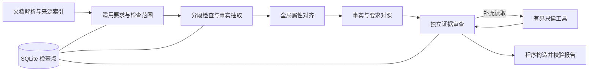

# 证据审查与评估

单文档、多文档对照和跨语种文本检查使用可恢复的 LangGraph 审查流程。用户选择自己的 Chat Completions 兼容模型，检查提示词定义业务要求。词表和链接检查使用本地规则，图片与视频任务使用多模态批次检查。

## 执行流程



1. 解析保留文档角色、章节、页码或段落、表格行与原文顺序，为片段生成稳定来源 ID。DOCX 包含正文、表格、页眉与页脚；PDF 保留页和结构化表格，无法读取的区域进入解析限制。
2. 根据业务提示词识别检查要求与全文核查范围。提示词中的参考条款直接作为判断依据，每项要求逐字引用来源，系统排除无法验证引用的要求。
3. 分批检查所有正文片段，每批返回来源覆盖、局部候选、可供全局比较的事实和逐项要求观察。同一任务的检查项共用来源索引，可以复用经原文验证的事实，业务覆盖分别计算。
4. 一致性与对照策略将同义属性和跨语种属性对齐，再比较对象、用途、条件、版本、原值与单位。较大的事实组按批次及批次之间对照。完整性与规范策略结合所有章节的要求观察；观察分批提供，同时保留全局覆盖状态计数。
5. 每批候选使用独立审查会话，阅读相关原文并寻找反证。模型按需调用白名单工具，系统限制取证轮次、工具参数与返回量。
6. 程序根据审查结果构造严格报告，排除无法核实的引用，将缺少依据的候选列入待核实。报告直接用于页面、HTML 和 Excel 导出。

局部表达检查跳过事实对齐和全局事实比较。没有候选时跳过候选复核。参考依据来自本次提交的文档和提示词，取证工具只读取本次任务来源。

## 业务提示词与内置策略

公共检查项由具有规则管理权限的账号维护名称、说明、提示词与启用状态，在同一页面新增扩展检查项并填写自定义业务提示词。内置与扩展文本模型检查统一使用证据审查流程，提交时保存提示词、执行参数和所选模型的快照，重试沿用该任务快照。

提示词适合明确以下信息：适用文档和读者、需要核对的内容、判定错误的条件、允许的差异、明确要求必须出现的信息。例如：

> 核对同一型号、同一版本和相同负载条件下的电压与电流参数。允许不同型号的参数差异，单位换算后的等价值视为一致。安装指南必须说明接线前断电。只将影响正确操作的明确问题列为问题，表达优化列为建议。

执行流程、工具选择、证据门槛和输出 schema 由系统提供。提示词描述业务判断，参考规范的适用条件与条款可直接写入提示词。

| 检查范围 | 内置处理 |
| --- | --- |
| 局部表达 | 检查片段内容，有候选时执行证据复核 |
| 全文一致性 | 抽取事实、对齐属性，跨章节比较参数与条件 |
| 内容完整性 | 汇总各章节对必需信息的覆盖观察，核实全文缺失 |
| 规范符合程度 | 按提示词给定条款检查适用性与符合程度 |
| 多文档对照 | 对比不同文档的事实与要求，保留素材和资料角色 |
| 跨语种对照 | 对齐不同语言的含义、参数与操作条件 |

任务类型和内置检查项确定基础流程，规划阶段根据完整业务提示词识别额外的全文核查范围。自定义检查同样支持组合一致性、完整性和规范核查。例如上述提示词同时执行参数对照与断电要求覆盖检查；局部表达提示词只执行必要的片段检查与复核。

## 用户模型配置

用户在“模型管理”中新增或编辑自己的提供商，每行模型 ID 配置思考强度和是否关闭思考。手工输入和拉取的模型使用相同配置方式，同一模型的不同思考模式可以分别配置。

每次回复的输出容量使用上游服务默认值，部分模型把思考与可见正文共同计入服务输出额度。公共检查、自定义检查、图片、视频和模型连接测试统一采用上游默认输出容量。

保存后对新提交任务生效，已提交任务及其重试使用提供商、模型和思考设置的配置快照。提供商的文本上限约束单次输入，执行期间另有内置请求次数、时间和取证轮次预算。

## 模型协议与工具

系统通过一次实际的强制工具读取验证模型原生工具能力；不支持或忽略工具调用时，自动使用经过契约校验的 JSON 动作。两种方式共用工具实现、参数校验和取证规则。

| 工具 | 作用 |
| --- | --- |
| `search_document` | 检索当前任务来源，支持中文关键词；无命中仅表示本次检索未找到 |
| `read_context` | 读取指定来源及同一文档的相邻片段 |
| `read_table` | 读取指定表格的请求行、表头与附近行，标记截断 |
| `compare_numbers` | 验证原文数值引用并换算已支持的单位；对象和条件由审查判断 |
| `coverage_status` | 查看解析与检查覆盖，以及逐项观察的状态计数和取证样本 |

模型适配器依次尝试 JSON schema、JSON mode 和提示词 schema；仅在明确的兼容错误时切换。温度参数和流式用量参数按服务能力处理。各阶段始终使用本地契约校验，结构错误最多修复一次；拒绝、持续截断和缺少完成标识的响应进入未完成状态。

要求规划根据输入字符预算将业务提示词按原文行分批，完整提示词持续提供共用条件。每批只提取指定提示词片段或标准来源中的要求，引用逐字核验。模型返回 `finish_reason=length` 时，规划缩小当前批次继续提取，保存分批游标和实际用量；无法继续拆分的单段执行一次精简输出重试。分批覆盖全部提示词原文，重试继续累计调用次数和执行时间。持续截断时，检查项明确显示未完成。

候选生成、属性对齐、全局对照和候选复核均支持截断后的自动拆批。候选生成按来源、要求或带重叠的原文区间拆分，引用逐字核实到当前区间；整个原始批次完成后才更新检查覆盖。全局事实对照保留各组内部与组间的全部比较，要求核查持续提供全文观察摘要和覆盖状态。复核缩小候选批次并保留已读取来源，单个目标执行一次精简输出重试。结构修复被截断时使用相同的拆批恢复流程。

思考内容以流式事件转交输出记录，正文分段归集后进行契约校验。响应是否结束以模型服务的完成标识为准，输出容量使用上游默认值，执行持续受请求次数、执行时间和取消状态约束。

## 证据门槛与报告

确认问题需要明确适用条件，引用必须逐字存在于已读取的来源。系统保留原文、文件名、章节、位置、文档角色和标准版本。审查结果分为确认、原文或条件已解释、证据不足，报告将问题、建议、待核实和撤回候选分别展示。

全文缺失判断需要源于提示词或标准的适用要求，并满足可靠解析及逐项检查覆盖。其他章节已覆盖要求，或观察仍不确定时，缺失候选保留为待核实。原文中的 TODO、TBD 等明确占位可提供局部缺失证据。图像、绘图和版式需要相应视觉证据，文本检查对缺乏视觉依据的结论保留待核实。

报告中的“待核实”不计入已确认问题。达到取证轮次上限时仍请求读取的候选进入待核实；达到请求、时间或候选预算时，检查项显示未完成，已审查结果与中间候选继续保留。解析不完整的文档明确显示已覆盖范围。

HTML 和 Excel 展示审查记录、覆盖与模型服务返回的 token 用量。模型服务缺少部分用量时，报告标明用量不完整。人工反馈保存在条目 ID 下，误报忽略规则对证据审查条目同时核对证据上下文指纹，防止只依据相似描述折叠不同内容。

## 预算、恢复与数据

| 内置执行预算 | 默认值 |
| --- | ---: |
| 每批来源字符数 | 10,000 |
| 单项模型请求上限 | 96 |
| 单项时间预算 | 3,600 秒 |
| 每批审查轮次 | 3 |
| 每批候选数 | 4 |
| 单项候选上限 | 200 |

每次 HTTP 尝试计入请求次数，协议切换、结构修复和服务重试均计入。服务返回的实际输入、输出 token 单独记录，累计用量用于页面、报告和离线评测统计。缺少用量时标记统计不完整，并仅累计已知用量。

模型服务返回 `length` 表示响应被截断，实际容量受上游默认输出额度和可用上下文空间约束。各阶段自动拆批与精简输出重试后仍截断时，检查项保留已完成的处理结果并显示未完成。

来源片段、提示词、schema、工具和状态摘要共同受模型的单次输入字符上限约束。单个来源、要求或事实超过上下文预算时，检查项明确报告未完成。长文档的分段检查仍受单项总预算约束。

检查项状态保存在 `task_checkpoints`，包含下一节点、已完成分批游标、当前拆分子批次、事实、覆盖、候选、决定和累计请求。来源、提示词、标准、模型及思考配置的签名匹配时，恢复从保存的节点与子批次继续，预算累计保留。写入同时校验任务认领令牌和取消状态，过期执行不能覆盖当前状态。

预处理、检查项并发、单项取消与手动重试由现有任务调度器管理。任务数据清理同时清除来源文本和检查点，保留报告、复核记录及用量。清理后的任务不具备来源文本评估条件，应在保留期内导出需要的样本。执行期间关闭 LangSmith 外部追踪。

## 人工标注与对照评测

质量评估在同一组人工标注文档上运行 `standard` 整文检查和 `agent` 证据审查。整文检查使用对应任务的上下文拼装与报告证据规则，标准原文向两个方案提供。评测输入为 JSON 数组或 JSONL，每个样本包含唯一 `id`、`documents`、`check` 和人工标注的 `expected_issues`。

文档可以直接填写文本，也可以用相对样本文件的 `path` 指向解析文件。每个真实问题使用唯一问题 ID，并记录严重程度。离线评测通过 `check.agent_options` 指定对照策略、预算或标准样本；线上任务使用内置策略和用户模型配置。多文档的文档角色是 `master` / `related`，跨语种角色是 `document_a` / `document_b`。

`tests/fixtures/evaluation_cases.json` 提供 10 个合成标注样本，覆盖型号与版本差异、同义表达、等价单位、视觉证据、缺失、跨文档、禁止含义与版本标准。该样本用于评测流程示例，线上质量验收使用具有代表性的真实文档、正例和反例。

在 PowerShell 7 中设置模型 Key 环境变量并运行：

```powershell
$env:DOCUMENTCHECK_EVAL_API_KEY = '<模型 Key>'
uv run python -m scripts.evaluate_checks run --cases tests/fixtures/evaluation_cases.json --variant both --api-base https://example.com/v1 --model your-model --ssl-verify --output instance/evaluation/runs.jsonl
```

结果逐条写入 JSONL，文件解析或单个样本失败会留下明确失败记录并继续其他样本。输出旁同时生成 `runs.annotations.json`，所有标签初始为 `unreviewed`。根据原文、业务要求和人工真值完成复核：

| 输出分类 | 可用标注 |
| --- | --- |
| 问题 | `true_positive` 或 `false_positive`；正确检出需要填写匹配的 `expected_id` |
| 建议 | `suggestion_accepted` 或 `suggestion_rejected` |
| 待核实 | `pending_issue`、`pending_non_issue` 或 `pending_unresolved` |
| 已撤回 | `withdrawn_correct` 或 `withdrawn_incorrect` |

用户认可与建议接纳分别记录，明确问题的真假需依据原文和要求复核。`expected_issues` 包含人工发现的漏检问题。完成整份文档的真值标注后，设置样本的 `gold_complete: true`；已有明确 `expected_issues` 且省略该字段的评测样本视为完成标注。

```powershell
uv run python -m scripts.evaluate_checks score --cases tests/fixtures/evaluation_cases.json --runs instance/evaluation/runs.jsonl --annotations instance/evaluation/runs.annotations.json --output instance/evaluation/scores.json
```

输出指标包括已复核问题的准确率、标注覆盖率、真实问题召回率、关键问题召回率、完整复核文档的每文档误报数、正确撤回比例、冗余检出、执行成功率、P50/P95 耗时、已知 token 和按币种统计的已知成本。待核实候选不计入已确认召回。未完成标注时，准确率或召回率保持未知；缺失和失败执行保留在分母及错误计数中。

可以将团队确定的验收门槛写入命令；以下数值仅示范参数：

```powershell
uv run python -m scripts.evaluate_checks score --cases instance/evaluation/cases.json --runs instance/evaluation/runs.jsonl --annotations instance/evaluation/runs.annotations.json --output instance/evaluation/scores.json --min-precision 0.90 --min-critical-recall 0.95 --max-p95-seconds 180
```

质量门槛要求人工真值和输出复核完整、全部执行成功。指标未知或未达门槛时命令返回退出码 1。方案耗时与 token 量取决于文档长度、全局事实规模、候选数、补充取证、模型响应和协议能力，使用同一组样本实测后调整预算与分批规模。

## 从人工反馈建立样本

显式指定部署数据库或只读副本，将仍保留来源文本的已结束文本任务导出为待标注样本：

```powershell
uv run python -m scripts.evaluate_checks export-feedback --database instance/document_check.sqlite3 --limit 100 --output-dir instance/evaluation/feedback
```

可重复指定 `--task-id` 选择任务。命令通过只读连接读取来源、检查快照、报告和反馈，输出 `cases.json`、`runs.json`、`annotations.json`、`skipped.json`。导出包含文档原文和业务提示词，应保存在相应的数据访问范围中。模型访问密钥、管理员配置和用户身份字段不进入导出。

生产反馈保存在 `feedback_hint`，输出标签保持 `unreviewed`，样本的 `gold_complete` 初始为 `false`。人工复核真假、补齐漏检和标记真值完整后，可以评估已保存的生产输出，也可以对同一批样本执行两个方案的对照检查。未保留来源文本或结构不完整的任务记录到 `skipped.json`。

## 实现与验证入口

核心入口是 `app/tasks/runtime/evidence_agent.py`，阶段契约在 `app/contracts/agent.py`，模型适配在 `app/models/agent.py`，工具在 `app/checks/evidence_tools.py`，检查点在 `app/persistence/checkpoints.py`。模块边界和回归命令见 [开发与模块边界](development.md)。

自动化测试验证流程、引用、覆盖、预算、恢复、取消、协议、严格报告、任务执行和导出。真实模型的检出质量与生产响应时间通过人工标注对照评测验收。
